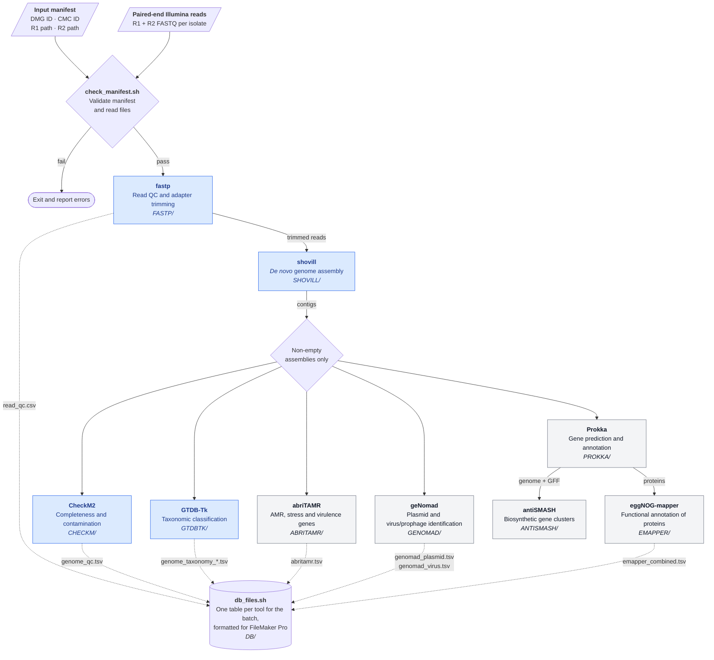

# microbiome-collection

**Pipeline for processing genomic data from the Centre for Pathogen Genomics Microbiome Collection (CMC)** — a biobank of genome-sequenced human gut microbiome isolates.  

This repository contains scripts for quality control, assembly, annotation, and taxonomic classification of isolate genomes. The workflow is designed for high-throughput processing of samples from a single sequencing batch (e.g. isolates sequenced periodically as part of an ongoing project), but it can be applied to any collection of bacterial isolates.

## Contents
- [Setup](#setup)
- [Quick Start](#quick-start)
- [Rerunning All Batches](#rerunning-all-batches)
- [Requirements](#requirements)
- [Input Manifest Format](#input-manifest-format)
- [Manifest Generation Utility](#manifest-generation-utility)
- [Pipeline Overview](#pipeline-overview)
- [Current Pipeline Steps](#current-pipeline-steps)
- [Database Files](#database-files)
- [Collection-wide Analysis](#collection-wide-analysis)
- [Next steps](#next-steps)

## Setup
Clone this repository into a working directory called `cmc/`. Manifests, per-batch outputs and collection-wide analyses are all kept in `cmc/`, alongside the repository:
```
cmc/
├── microbiome-collection/   # this repository
├── MANIFESTS/               # input manifests, one per batch
├── CMC_DB/                  # pipeline output, one directory per batch
└── ANALYSIS/                # collection-wide analysis outputs
```

```bash
mkdir cmc && cd cmc
git clone https://github.com/centre-pathogen-genomics/microbiome-collection.git
mkdir -p MANIFESTS CMC_DB
```

All commands below are run from `cmc/`. The scripts find each other relative to their own location, so they can be called by their path within the repository.

## Quick Start
The pipeline requires two positional arguments
- path to the input manifest (see _Input Manifest Format_ below)
- output directory

For example, from `cmc/`:
```bash
microbiome-collection/cmc.sh MANIFESTS/Run1 CMC_DB/Run1/
```

To get a quick look at a batch (read QC, assembly, CheckM2 and GTDB-Tk only, without annotation), run:
```bash
microbiome-collection/SCRIPTS/cmc_prelim.sh MANIFESTS/Run1 CMC_DB/Run1/
```

Each processing step is implemented as an individual script in the SCRIPTS/ directory, which can be either run separately or as part of the full pipeline.  
When running the full pipeline, each step will only run if the relevant output directory does not exist. 

If you want to only run the Prokka annotation step, you can do either of the following:  

Run the relevant script specifying the output directory (each step will identify its own input files based on outputs generated by previous steps)
```bash
microbiome-collection/SCRIPTS/prokka.sh CMC_DB/Run1/
```

Or delete the current output directory and run the full pipeline
```bash
rm -rf CMC_DB/Run1/PROKKA
microbiome-collection/cmc.sh MANIFESTS/Run1 CMC_DB/Run1/
```

Notes:
- Individual steps can only be run on an output directory that `cmc.sh` or `cmc_prelim.sh` has already been run on at least once. That first run creates the hidden `.manifest`, `.asspaths` and `.assnames` files that each step reads.
- geNomad, Prokka, eggNOG-mapper and antiSMASH create their output directory before they start. If one of these steps fails, delete its output directory before rerunning `cmc.sh`, otherwise the step will be skipped.

## Rerunning All Batches
`SCRIPTS/rerun_all.sh` reruns `cmc.sh` on every batch that has already been processed, e.g. after adding a new step or updating a tool. A batch is included if it has an output directory `CMC_DB/<batch>/` and a matching manifest `MANIFESTS/<batch>`. Output directories with no manifest, and manifests for batches that have not been processed yet, are listed and skipped.

Steps to rerun are given as output directory names (case-insensitive). These directories are deleted in every batch before `cmc.sh` is run, so the steps are run again:
```bash
microbiome-collection/SCRIPTS/rerun_all.sh GENOMAD          # redo geNomad in every batch
microbiome-collection/SCRIPTS/rerun_all.sh                  # only run steps whose output directories are missing
microbiome-collection/SCRIPTS/rerun_all.sh --dry-run PROKKA # show what would be deleted and run
```

- Steps that use the output of a named step are rerun too: `FASTP` reruns everything, `SHOVILL` reruns every step after assembly, and `PROKKA` also reruns eggNOG-mapper and antiSMASH.
- `DB/` is rebuilt in any batch where a step is run, so the database tables include the new outputs.
- Batches with nothing to run are skipped.
- The plan for each batch is printed and must be confirmed before anything is deleted. Use `--dry-run` to only print the plan, or `--yes` to skip the confirmation (e.g. when running with `nohup`).
- Batches run one at a time. Each batch's output is written to `CMC_DB/<batch>/rerun_<date>_<time>.log`, and if a batch fails the script moves on to the next one. A batch is reported as failed if `cmc.sh` exits with an error or any step that should have run has no output directory. A summary is printed at the end.
- `THREADS` is passed through to every step, e.g. `THREADS=48 microbiome-collection/SCRIPTS/rerun_all.sh GENOMAD`.

Runs can take many hours, so start it in `tmux`/`screen`, or with `nohup` and `--yes`:
```bash
nohup microbiome-collection/SCRIPTS/rerun_all.sh --yes GENOMAD > rerun.nohup 2>&1 &
```

## Requirements
Each step activates its own conda environment. Paths to conda, the environments and the reference databases are currently hardcoded in each script, so update these if running on a different system:

|Environment|Used by|
|---|---|
|fastp|fastp.sh, db_files.sh, db_files_prelim.sh (also needs `jq` and `csvtk`)|
|shovill|shovill.sh|
|checkm2|checkm.sh|
|gtdbtk|gtdbtk_classify.sh, denovotree.sh (also needs `csvtk`)|
|abritamr|abritamr.sh|
|genomad|genomad.sh|
|prokka|prokka.sh|
|eggnog-mapper|emapper.sh|
|antismash|antismash.sh|
|drep|drep.sh (also needs `csvtk`)|

`cmc_summarise.sh` does not activate a conda environment and needs `csvtk` and GNU `parallel` available on the PATH.

Every step uses 24 threads by default. To change this, set `THREADS` when launching, e.g. `THREADS=48 microbiome-collection/cmc.sh MANIFESTS/Run1 CMC_DB/Run1/`.

## Input Manifest Format
The input manifest is a headerless TSV file with four columns, one row per isolate:
|Column|Description|
|---|---|
|1|Sample basename (e.g. sequencing ID or barcode, e.g. DMG2306286). Only checked during validation and not used by the pipeline itself; `makeinputmanifest.sh` uses it to find the FASTQs|
|2|CMC isolate ID. All output files and folders are named by this ID|
|3|Absolute path to R1 FASTQ|
|4|Absolute path to R2 FASTQ|

Example:
```
DMG2306286    CMC00001    /home/data/DMG2306286_S249_R1_001.fastq.gz    /home/data/DMG2306286_S249_R2_001.fastq.gz
DMG2306287    CMC00002    /home/data/DMG2306287_S250_R1_001.fastq.gz    /home/data/DMG2306287_S250_R2_001.fastq.gz
DMG2306288    CMC00003    /home/data/DMG2306288_S251_R1_001.fastq.gz    /home/data/DMG2306288_S251_R2_001.fastq.gz
```

Before anything runs, the manifest is checked by `microbiome-collection/SCRIPTS/check_manifest.sh` (which can also be run on its own). The pipeline will exit if the manifest:
- has Windows (CRLF) line endings or no trailing newline
- has any row without exactly four tab-separated, non-empty columns
- contains spaces in any column
- contains duplicate sample basenames, CMC IDs or read files, or uses the same file for R1 and R2
- points to read files that are missing or empty

## Manifest Generation Utility
A helper script is provided to automatically generate the manifest.
If you have a two-column, tab-separated file (called _names_ in the example below) containing sample basenames and CMC IDs, and a directory with the FASTQs, you can run:
```bash
microbiome-collection/SCRIPTS/makeinputmanifest.sh names /path/to/data/Run1/
```
This simple script loops over each entry in names, lists the corresponding R1 and R2 FASTQs in the specified directory, and creates a complete four-column manifest.
The manifest is written to `cmc/MANIFESTS/<name of the reads directory>` (with no file extension). In the example above this would be `MANIFESTS/Run1`.

(Note: this script is not smart — it assumes consistent file naming and structure. FASTQs must be named `<sample basename>_S*_R1_001.fastq.gz` and `<sample basename>_S*_R2_001.fastq.gz`, and the names file must be tab-separated, otherwise the manifest will fail validation.)

## Pipeline Overview


Steps shaded blue are also run by `cmc_prelim.sh`, which writes its tables to `DB_PRELIM/` instead of `DB/`. Dotted arrows show which outputs are combined into the database tables (see _Database Files_ below).

## Current Pipeline Steps
|Step|Tool|Purpose|Output directory|
|---|---|---|---|
|1|[fastp](https://github.com/OpenGene/fastp)|Quality control and adapter trimming|FASTP/|
|2|[shovill](https://github.com/tseemann/shovill)|_De novo_ genome assembly|SHOVILL/|
|3|[CheckM2](https://github.com/chklovski/CheckM2)|Assembly quality assessment|CHECKM/|
|4|[GTDB-Tk](https://github.com/Ecogenomics/GTDBTk)|Taxonomic classification|GTDBTK/|
|5|[abriTAMR](https://github.com/MDU-PHL/abritamr)|AMR profiling|ABRITAMR/|
|6|[geNomad](https://github.com/apcamargo/genomad)|Identify plasmid and virus/prophage contigs|GENOMAD/|
|7|[Prokka](https://github.com/tseemann/prokka)|Genome annotation|PROKKA/|
|8|[eggNOG-mapper](https://github.com/eggnogdb/eggnog-mapper)|Functional annotation of Prokka-predicted proteins|EMAPPER/|
|9|[antiSMASH](https://github.com/antismash/antismash)|Identify secondary metabolite biosynthetic gene clusters|ANTISMASH/|
|10|`db_files.sh`|Combine per-isolate outputs into database tables|DB/|

Steps 3 onwards only run on isolates with a non-empty assembly. Software versions for each step are written to VERSIONS/.

geNomad is run once per batch rather than once per isolate, so its database is only loaded once. `genomad.sh` concatenates all non-empty assemblies into one file, prefixing each contig name with its CMC ID (e.g. `CMC00001__contig00001`), since shovill gives every assembly the same contig names. The length and coverage from the shovill contig headers are saved to `GENOMAD/shovill_coverage.tsv` and added to the database tables. The batch-level geNomad results are in `GENOMAD/cmc_batch_summary/`, and the plasmid and virus sequences are also split into one file per isolate (`GENOMAD/<CMC ID>/<CMC ID>_plasmid.fna` and `_virus.fna`).

## Database Files
The final step (`SCRIPTS/db_files.sh`) combines the per-isolate outputs into one table per tool for the whole batch, formatted for import into FileMaker Pro. Each table has one row per isolate (or per hit) and a column identifying the CMC isolate: `SampleID` in read_qc.csv, abritamr.tsv and emapper_combined.tsv, `Name` in genome_qc.tsv, and `user_genome` in the taxonomy tables. Tables are written to `DB/` in the output directory:

|File|Source|Contents|
|---|---|---|
|read_qc.csv|fastp JSON reports|Post-filtering read and base counts, Q20/Q30 rates, mean read lengths, GC content and counts of reads removed by each filter|
|genome_qc.tsv|CheckM2 quality_report.tsv|CheckM2 completeness, contamination and assembly statistics, plus a `QC_Notes` column: `pass`, or `low completeness` (<90%) and/or `high contamination` (≥5%)|
|genome_taxonomy_bac.tsv|GTDB-Tk bac120 summary|GTDB taxonomic classification of bacterial genomes (without the long `other_related_references` column)|
|genome_taxonomy_ar.tsv|GTDB-Tk ar53 summary|As above for archaeal genomes (only created if any were found)|
|abritamr.tsv|AMRFinderPlus output from abriTAMR|All AMR, stress and virulence gene hits|
|genomad_plasmid.tsv|geNomad plasmid summary|One row per contig classified as plasmid, with the geNomad plasmid score, topology, hallmark, conjugation and AMR genes, plus the contig's shovill `shovill_length` and `shovill_coverage`|
|genomad_virus.tsv|geNomad virus summary|One row per viral contig or prophage region (prophages have a `\|provirus_<start>_<end>` suffix on the contig name), with the geNomad virus score and taxonomy, plus the shovill length and coverage of the contig it was found on|
|emapper_combined.tsv|eggNOG-mapper annotations|All eggNOG-mapper annotations, one row per protein|

`cmc_prelim.sh` runs `SCRIPTS/db_files_prelim.sh` instead, which only produces read_qc.csv, genome_qc.tsv and the taxonomy tables, and writes them to `DB_PRELIM/` so they are kept separate from the full pipeline outputs in `DB/`.

## Collection-wide Analysis
Three further scripts combine and compare genomes across all processed batches, rather than a single batch. Like the rest of the pipeline they are run from `cmc/`, and expect each batch's pipeline output to be in `CMC_DB/<batch>/`. All outputs are written to `cmc/ANALYSIS/`, which is created if needed, so the paths in the table below are relative to `ANALYSIS/`. Run them in this order:
```bash
microbiome-collection/SCRIPTS/cmc_summarise.sh
microbiome-collection/SCRIPTS/drep.sh
microbiome-collection/SCRIPTS/denovotree.sh
```

|Script|Inputs|Outputs|Purpose|
|---|---|---|---|
|`cmc_summarise.sh`|`CMC_DB/*/DB/` tables from each batch|`DB_FILES/cmc_genome_qc.tsv`, `cmc_genome_tax.tsv`, `cmc_read_qc.tsv`, their `*_filtered.tsv` versions, and `manifest.tsv`|Combine the read QC, genome QC and bacterial taxonomy tables from every batch, and filter to genomes with CheckM2 completeness ≥90% and contamination <5%. `manifest.tsv` lists the CMC ID and assembly path of each genome passing QC|
|`drep.sh`|`DB_FILES/manifest.tsv`, `DB_FILES/cmc_genome_qc_filtered.tsv`|`DREP/<threshold>/`, `DB_FILES/drep_clusterinfo.csv`, `drep_clusterreps.csv`, `drep_99anipairs.csv`|Dereplicate QC-passing genomes with [dRep](https://github.com/MrOlm/drep) (fastANI) at 95, 98, 99, 99.9, 99.99 and 99.999% ANI|
|`denovotree.sh`|`DB_FILES/manifest.tsv`, `DB_FILES/cmc_genome_tax_filtered.tsv`|`DENOVOTREE/`|Build a GTDB-Tk _de novo_ bacterial tree of QC-passing genomes, without GTDB reference genomes, rooted on p__Pseudomonadota|

The dRep tables in `DB_FILES/` are:
|File|Contents|
|---|---|
|drep_clusterinfo.csv|The cluster each genome belongs to at every ANI threshold, one row per genome|
|drep_clusterreps.csv|The representative genome chosen for each cluster at every threshold|
|drep_99anipairs.csv|All genome pairs with ≥99% ANI, with ANI and alignment coverage|

## Next steps
Major
- rewrite in Nextflow  

Minor
- Add support for ONT and hybrid assemblies
- Alternative taxonomic classification: [Barbet](https://github.com/houndry/barbet)
- Alternative annotation: [Bakta](https://github.com/oschwengers/bakta)
- Functional profiling: [gutSMASH](https://github.com/victoriapascal/gutsmash)
- Bacteriocin detection: [BAGEL](https://github.com/annejong/BAGEL4)
- CAZyme detection: [dbCAN3](https://bcb.unl.edu/dbCAN3/)
- Phenotypic trait prediction: [Traitar](https://github.com/hzi-bifo/traitar)
